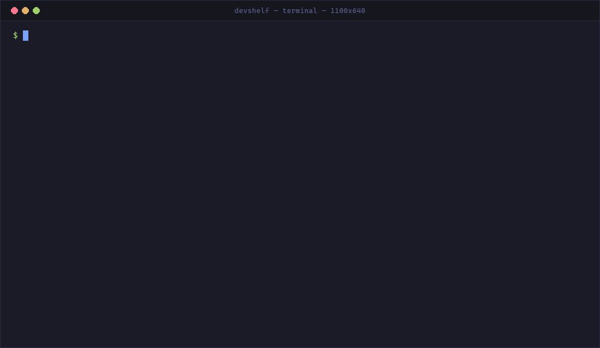

# DevShelf

**A CI-audited, zero-paywall directory of 601 developer tools, free APIs, and MCP servers — searchable in your terminal, browser, or inside Claude/Cursor via MCP.**

[](https://github.com/RitualDev-Lab/DevShelf/actions/workflows/ci.yml)
[](https://www.npmjs.com/package/@ritualdev-lab/devshelf)
[](LICENSE)
[](#-how-to-submit-your-project-or-api)

No link rot. No "14-day free trial" bait. Unsigned native binaries are explicitly flagged by automated CI policy checks.

### Try it in 5 seconds

```bash
# Search 601 CI-audited tools directly from your terminal
npx @ritualdev-lab/devshelf search "postgres"

# Or plug the catalog into Claude Desktop / Cursor / Windsurf as an MCP server
npx @ritualdev-lab/devshelf mcp
```

```text
$ npx @ritualdev-lab/devshelf search "postgres"
📚 DevShelf CLI — 601 Curated Tools (CI Link & Binary-Trust Audited)

[1] Neon (Database / Serverless)
    Serverless Postgres with branching and free tier (0.5 GB storage)
    https://neon.tech

[2] Supabase (Database & BaaS)
    Open-source Postgres platform with Auth, Storage & Edge Functions
    https://supabase.com
```

<p align="center">
  
</p>

> Recorded with [Charm VHS](https://github.com/charmbracelet/vhs) from [`assets/demo.tape`](assets/demo.tape).

### Built an open-source CLI, API, or MCP server? Add it in a 5-line JSON PR

DevShelf is community-curated. Every merged PR automatically publishes your tool to the terminal CLI, the [public JSON API](https://devshelf.ritualdev.in/api/v1/tools.json), the MCP server, and a live dossier page on [devshelf.ritualdev.in](https://devshelf.ritualdev.in).

1. Fork this repo and add one JSON entry to the matching file under `shelf/` (e.g. `shelf/cli-tools.json` or `shelf/ai-llms.json`).
2. Open a PR — our automated validator checks schema, live HTTPS reachability, and binary code-signing metadata in seconds.

[Web Directory](https://devshelf.ritualdev.in) · [Public JSON API](https://devshelf.ritualdev.in/api/v1/tools.json) · [Submit Your Tool](#-how-to-submit-your-project-or-api) · [MCP Setup](docs/mcp.md)

| 🌐 Free APIs | 🤖 AI & LLMs | ⚡ CLI Tools | 🧪 Testing & QA | ☁️ Free Cloud | 🤝 Up for Grabs | 🎁 Dev Perks | 🚀 1-Click Deploys |
| :---: | :---: | :---: | :---: | :---: | :---: | :---: | :---: |
| `111` | `116` | `140` | `68` | `73` | `21` | `30` | `42` |

---

## 🥊 Why DevShelf Beats Legacy "Awesome Lists"

Most developer resource lists (*public-apis*, *free-for-dev*) suffer from link rot, abandoned projects, and sneaky "free 14-day trials". DevShelf solves this with **3 unfair advantages**:

| Dimension | 🧟 Static Awesome Lists & Repos | 🚀 DevShelf |
| :--- | :--- | :--- |
| **Endpoint Health** | 40%+ broken links & dead APIs sitting for years | 🛡️ **Automated CI Health Checks** ping every endpoint continuously |
| **Trial-Bait Protection** | Riddled with "14-day trials" & bait-and-switch pricing | 🚫 **Strict Zero-Paywall Audit** &mdash; 100% free forever tiers or MIT/Apache FOSS |
| **Developer Access** | Read-only markdown tables; constant browser tab flipping | ⚡ **Zero-Install CLI (`npx devshelf`)** & fuzzy TUI right in your terminal |
| **AI Agent Native** | None (manual copying and pasting into chat) | 🤖 **Official MCP Server (`npx -y @ritualdev-lab/devshelf mcp`)** for Claude, Cursor, & Zed |
| **Data Programmability** | Static markdown formatting | 📡 **Free CORS JSON REST API (`/api/v1/tools.json`)** with no keys needed |
| **Creator Backing** | Submissions sit unreviewed for months with zero recognition | 📢 **Social Amplification Guarantee** &mdash; merged tools get featured on X & LinkedIn |

---

## 🛡️ Independent Verification & Freshness Architecture

DevShelf does not rely on subjective claims or stale markdown lists. Catalog integrity is grounded in three separate, automated verification tiers and an explicit sponsor transparency policy:

1. 🌐 **Reachable Web Endpoint (`lastCheckedAt`)**
   - Automated HTTP probe and DNS resolution tests tracking 200 OK and canonical 301/308 redirects.
   - Resilient against Cloudflare / Vercel anti-bot challenge false-positives.
   - Enforces an automated **14-day grace period** before any broken URL enters sunset delisting.

2. 🔌 **Working API & Service Health (`lastVerifiedAt`)**
   - Automated endpoint connectivity and payload validation for public APIs and developer services.
   - Ensures mock APIs, inference endpoints, and tool APIs return parseable data matching their schemas.

3. 💳 **Verified Zero-Paywall & Pricing Policy (`pricingVerifiedAt`)**
   - Automated regex and human audit heuristic scans for trial-bait detection.
   - Enforces permanent free access: mandatory upfront credit cards or expiring 14-day trial traps are rejected.

4. 🎖️ **Sponsor & Partner Independence Disclosure**
   - **Editorial Independence**: Sponsored partner tools, directory spotlight slots, and patron badges are strictly labeled with `[Sponsored]` or `[Patron Backed]` tags.
   - **Sponsoring does not bypass audits**: Sponsored tools must meet the exact same reachability and zero-paywall criteria as organic entries.
   - Organic search rankings, categorization, and recommendation algorithms remain 100% unbiased.

---

## 🤖 Official MCP Server for AI Agents

Turn your AI coding assistant into a free developer tool & API search engine! DevShelf implements the official **Model Context Protocol (MCP)** over stdio:

```bash
# 1-Line Install for Claude Desktop via Smithery
npx -y @smithery/cli install devshelf-mcp --client claude

# Or run stdio server directly for Cursor, Claude Desktop, Windsurf, or Zed
npx -y @ritualdev-lab/devshelf mcp
```

### 1-Click Cursor Configuration (`.cursor/mcp.json`)
```json
{
  "mcpServers": {
    "devshelf": {
      "command": "npx",
      "args": ["-y", "@ritualdev-lab/devshelf", "mcp"]
    }
  }
}
```

👉 **[Read Full MCP Setup Guide for Claude Desktop, Cursor, Windsurf & Zed →](docs/mcp.md)**

---

## ⚡ DevShelf CLI & Terminal Discovery

Stay in flow without leaving your terminal. DevShelf includes an interactive fuzzy TUI and fast CLI utilities:

```bash
# Launch interactive Terminal UI (fuzzy search, category browsing, and 1-click open)
npx devshelf

# Instant search across all 600+ curated resources
npx devshelf search "postgres"
npx devshelf search "auth" --open

# Get your daily open-source discovery (add to ~/.zshrc or ~/.bashrc)
npx devshelf daily --quiet

# Find open-source projects actively seeking contributors & starter issues
npx devshelf contribute "rust"

# Discover a random resource for inspiration
npx devshelf random

# View live catalog telemetry and counts
npx devshelf stats
```

---

## 📂 Browse Catalog by Category

Explore our curated collections of **601+ zero-paywall developer tools**, categorized into dedicated guides with subcategory indexing:

| Category | Resources | Description & Subcategories | Guide |
| :--- | :---: | :--- | :---: |
| 🌐 **Free & Public APIs** | **111** | Weather, Finance, Mock/Dev APIs, Geocoding, AI/ML, Media, Entertainment | [**Browse APIs →**](docs/apis.md) |
| 🤖 **AI Agents & Local LLMs** | **116** | Local LLM Runtimes, Autonomous Agents, Coding Assistants, Orchestration | [**Browse AI Tools →**](docs/ai-tools.md) |
| ⚡ **CLI & Productivity Tools** | **140** | Terminal Utilities, Git Power Tools, Docker & DevOps, Benchmarking, DBs | [**Browse CLI Tools →**](docs/cli-tools.md) |
| 🧪 **Testing & QA Reliability** | **68** | E2E Testing, Mock Servers, Contract Testing, Security Auditing, Performance | [**Browse Testing Tools →**](docs/testing-qa.md) |
| ☁️ **Free Cloud & Developer Tiers** | **73** | Databases, Auth & Identity, Serverless Compute, Object Storage, Email, APM | [**Browse Cloud Tiers →**](docs/free-cloud.md) |
| 🤝 **Contributors Wanted** | **21** | Active open-source repos with curated Good First Issues and starter tasks | [**Browse Projects →**](docs/contributors-wanted.md) |
| 🎁 **Developer Discounts & Perks** | **30** | Cloud credits, free IDE licenses, student packs, open-source sponsorships | [**Browse Perks →**](docs/perks.md) |
| 🚀 **1-Click Deploys & Boilerplates** | **42** | Full-Stack templates, SaaS starters, BaaS, microservices deployable in 1 click | [**Browse Boilerplates →**](docs/boilerplates.md) |

---

## 🔥 Featured Spotlight & Tools of the Week

> Every week, we highlight outstanding open-source utilities, developer gems, and community submissions.

| Project | Category | Highlights | Links |
| :--- | :--- | :--- | :---: |
| **AgentShield** | AI Agent Security | Sub-0.10ms Linux eBPF/Landlock kernel sandbox & zero-leak secret redactor for autonomous coding agents. | [GitHub](https://github.com/RitualDev-Lab/AgentShield) |
| **DBShield** | Database Guardrails | Wire-level SQL proxy with lock-free dry-run rollbacks, PII masking, and Slack/Teams human approval gates. | [GitHub](https://github.com/RitualDev-Lab/DBShield) |
| **SkillPrism** | AI Context & FinOps | JIT semantic MCP tool compaction stacked with prompt caching for 98%+ prompt token reduction. | [GitHub](https://github.com/RitualDev-Lab/SkillPrism) |
| **Ollama** | Local AI & Inference | Run Llama 3.3, Mistral, Qwen, and custom models locally with a simple CLI and REST API. | [GitHub](https://github.com/ollama/ollama) |
| **Bruno** | API Testing & Exploration | Fast, git-friendly open-source API client storing collections directly in your repo in plain text. | [GitHub](https://github.com/usebruno/bruno) |
| **PocketBase** | Databases & BaaS | Open-source backend in 1 single binary file with embedded SQLite, realtime subscriptions, and auth. | [Website](https://pocketbase.io) |

---

## 🚀 Social Amplification Guarantee

> [!IMPORTANT]
> ### 📢 We Promote Your Project When You Get Listed!
> Building great developer tools is hard. Getting discovered is even harder.  
> **When your tool, API, or project is accepted and merged into DevShelf:**
> 1. **🌟 Social Media Spotlight**: We publish a dedicated shoutout post about your project on **X (Twitter)** and **LinkedIn** via the RitualDev Lab channels.
> 2. **🌐 Permanent Web Directory Inclusion**: Your tool is permanently listed in our live search index at [devshelf.ritualdev.in](https://devshelf.ritualdev.in).
> 3. **🔗 High-Quality Backlink**: Guaranteed direct dofollow backlink to your GitHub repository or documentation.

---

## 🎖️ "Featured on DevShelf" Badges

Are you listed on DevShelf? Display an official badge on your project's `README.md` to show off your community verification:

### Style 1: Modern Purple (Recommended)
[](https://devshelf.ritualdev.in/)

```markdown
[](https://devshelf.ritualdev.in/)
```

### Style 2: Cyberpunk Neon Cyan
[](https://devshelf.ritualdev.in/)

```markdown
[](https://devshelf.ritualdev.in/)
```

### Style 3: Minimal Flat Square
[](https://devshelf.ritualdev.in/)

```markdown
[](https://devshelf.ritualdev.in/)
```

---

## ⚡ DevShelf Public REST API (v1)

DevShelf is backed by a 100% free, CORS-enabled, static public REST API with zero rate-limiting or registration requirements:

| Endpoint | Method | Description |
| :--- | :--- | :--- |
| **[`/api/v1/tools.json`](https://devshelf.ritualdev.in/api/v1/tools.json)** | `GET` | All 600+ curated developer tools, APIs, and AI models |
| **[`/api/v1/stats.json`](https://devshelf.ritualdev.in/api/v1/stats.json)** | `GET` | Catalog telemetry, repo counts, and category breakdowns |
| **[`/api/v1/categories.json`](https://devshelf.ritualdev.in/api/v1/categories.json)** | `GET` | Category listing and dedicated JSON endpoints |

👉 **Read the complete [API Documentation & Code Samples (TypeScript, Python, cURL) →](docs/api.md)**

---

## 🧩 IDE & Launcher Extensions

Query and explore 600+ free developer tools directly within your workflow:

- **[Raycast Extension](extensions/raycast/)** &mdash; Instant tool search & random gem picker from your desktop spotlight (`Cmd+Shift+B` to copy badges).
- **[VS Code Extension](extensions/vscode/)** &mdash; Command Palette integration (`Ctrl+Shift+P` -> `DevShelf: Search`).
- 👉 **[Read Extension Guides & Installation →](docs/extensions.md)**

---

## 🎃 Hacktoberfest 2026

DevShelf is proud to participate in **Hacktoberfest 2026**! We welcome beginner and experienced open-source contributors with automated PR validation and prompt reviews:

- 🍁 **[Read Hacktoberfest Guide & Standards →](HACKTOBERFEST.md)**
- 🚀 **[Claim a Starter Issue →](https://github.com/RitualDev-Lab/DevShelf/issues/new?template=08_hacktoberfest_task.yml)**

---

## 👥 Team & Contributors

DevShelf is initiated by the team at [RitualDev Lab](https://github.com/RitualDev-Lab) and expanded by the global open-source community.

### 🛡️ Core Team & Maintainers

<table align="center">
  <tr>
    <td align="center" width="180">
      <a href="https://github.com/divyanshujethi">
        <br />
        <sub><b>Divyanshu Jethi</b></sub>
      </a><br />
      <sub>🚀 Founder & Lead</sub>
    </td>
    <td align="center" width="180">
      <a href="https://github.com/Sakshisharma1616">
        <br />
        <sub><b>Sakshi Sharma</b></sub>
      </a><br />
      <sub>🎨 Core Maintainer & Product</sub>
    </td>
    <td align="center" width="180">
      <a href="https://github.com/Ritual-Dev-Git">
        <br />
        <sub><b>RitualDev</b></sub>
      </a><br />
      <sub>⚙️ Core Maintainer & Infra</sub>
    </td>
    <td align="center" width="180">
      <a href="https://github.com/Divyanshu-hub-dotcom">
        <br />
        <sub><b>Divyanshu-hub-dotcom</b></sub>
      </a><br />
      <sub>🛠️ Core Member</sub>
    </td>
    <td align="center" width="180">
      <a href="https://github.com/ayushxx01">
        <br />
        <sub><b>Ayush</b></sub>
      </a><br />
      <sub>🛡️ Core Maintainer & Triage</sub>
    </td>
  </tr>
</table>

### 🌟 Community Contributors & Builders

<table align="center">
  <tr>
    <td align="center" width="160">
      <a href="https://github.com/Voyagerroc-Lab">
        <br />
        <sub><b>Voyagerroc-Lab</b></sub>
      </a><br />
      <sub>🔤 Coding Fonts (PR #35)</sub>
    </td>
    <td align="center" width="160">
      <a href="https://github.com/ayushxx01">
        <br />
        <sub><b>ayushxx01</b></sub>
      </a><br />
      <sub>🐶 Dog API (PR #36)</sub>
    </td>
    <td align="center" width="160">
      <a href="https://github.com/pranshuchittora">
        <br />
        <sub><b>pranshuchittora</b></sub>
      </a><br />
      <sub>🧪 Agent QA (PR #37)</sub>
    </td>
    <td align="center" width="160">
      <a href="https://github.com/KRISHNAMMurarka">
        <br />
        <sub><b>KRISHNAMMurarka</b></sub>
      </a><br />
      <sub>⚡ Budget Gate (PR #41)</sub>
    </td>
    <td align="center" width="160">
      <a href="https://github.com/louis030195">
        <br />
        <sub><b>louis030195</b></sub>
      </a><br />
      <sub>🧠 Hyperconsciousness (PR #44)</sub>
    </td>
  </tr>
  <tr>
    <td align="center" width="160">
      <a href="https://github.com/deiucanta">
        <br />
        <sub><b>deiucanta</b></sub>
      </a><br />
      <sub>🖥️ Easypanel (PR #56)</sub>
    </td>
    <td align="center" width="160">
      <a href="https://github.com/mahdi-salmanzade">
        <br />
        <sub><b>mahdi-salmanzade</b></sub>
      </a><br />
      <sub>🇦🇪 MCP Dubai (PR #53)</sub>
    </td>
    <td align="center" width="160">
      <a href="https://github.com/BlueSkyID666">
        <br />
        <sub><b>BlueSkyID666</b></sub>
      </a><br />
      <sub>🎬 OrkasVideoStudio (PR #55)</sub>
    </td>
    <td align="center" width="160">
      <a href="https://github.com/yannickmonney">
        <br />
        <sub><b>yannickmonney</b></sub>
      </a><br />
      <sub>📜 Tale (PR #59)</sub>
    </td>
    <td align="center" width="160">
      <a href="https://github.com/Eigenwise">
        <br />
        <sub><b>Eigenwise</b></sub>
      </a><br />
      <sub>🛠️ Toolshed (PR #61)</sub>
    </td>
  </tr>
  <tr>
    <td align="center" width="160">
      <a href="https://github.com/foklepoint">
        <br />
        <sub><b>foklepoint</b></sub>
      </a><br />
      <sub>⚖️ Court Rules (PR #63)</sub>
    </td>
    <td align="center" width="160">
      <a href="https://github.com/stefanautomateed">
        <br />
        <sub><b>stefanautomateed</b></sub>
      </a><br />
      <sub>🚢 Shipvela (PR #65)</sub>
    </td>
    <td align="center" width="160">
      <a href="https://github.com/zealous1">
        <br />
        <sub><b>zealous1</b></sub>
      </a><br />
      <sub>🎬 Arcmira (PR #67, #124-#126)</sub>
    </td>
    <td align="center" width="160">
      <a href="https://github.com/jeshuadomingo-byte">
        <br />
        <sub><b>jeshuadomingo-byte</b></sub>
      </a><br />
      <sub>💬 Caption-Pack (PR #68)</sub>
    </td>
    <td align="center" width="160">
      <a href="https://github.com/Jamailar">
        <br />
        <sub><b>Jamailar</b></sub>
      </a><br />
      <sub>⚡ LeanFPS (#70)</sub>
    </td>
  </tr>
  <tr>
    <td align="center" width="160">
      <a href="https://github.com/Shaisolaris">
        <br />
        <sub><b>Shaisolaris</b></sub>
      </a><br />
      <sub>☀️ Solaris Dev Shop (#71, #93)</sub>
    </td>
    <td align="center" width="160">
      <a href="https://github.com/estevecastells">
        <br />
        <sub><b>estevecastells</b></sub>
      </a><br />
      <sub>⚡ Invokely (PR #74)</sub>
    </td>
    <td align="center" width="160">
      <a href="https://github.com/Alox1d">
        <br />
        <sub><b>Alox1d</b></sub>
      </a><br />
      <sub>📦 Community Tool (#76)</sub>
    </td>
    <td align="center" width="160">
      <a href="https://github.com/Dramex">
        <br />
        <sub><b>Dramex</b></sub>
      </a><br />
      <sub>🛡️ RowSafe (PR #77, #86, #87, #90)</sub>
    </td>
    <td align="center" width="160">
      <a href="https://github.com/SergiuPogor">
        <br />
        <sub><b>SergiuPogor</b></sub>
      </a><br />
      <sub>📸 CurlShot (PR #79)</sub>
    </td>
  </tr>
  <tr>
    <td align="center" width="160">
      <a href="https://github.com/harshitethic">
        <br />
        <sub><b>harshitethic</b></sub>
      </a><br />
      <sub>🔍 ClonePeek (#80)</sub>
    </td>
    <td align="center" width="160">
      <a href="https://github.com/yumaheymans">
        <br />
        <sub><b>yumaheymans</b></sub>
      </a><br />
      <sub>🏥 CareJobs.Now (PR #83)</sub>
    </td>
    <td align="center" width="160">
      <a href="https://github.com/mountainowl">
        <br />
        <sub><b>mountainowl</b></sub>
      </a><br />
      <sub>🦉 Bubo (PR #89)</sub>
    </td>
    <td align="center" width="160">
      <a href="https://github.com/cpys">
        <br />
        <sub><b>cpys</b></sub>
      </a><br />
      <sub>📊 Codex Quota Overlay (#38)</sub>
    </td>
    <td align="center" width="160">
      <a href="https://github.com/InsightFactoryAPP">
        <br />
        <sub><b>InsightFactoryAPP</b></sub>
      </a><br />
      <sub>🚀 YYLO (#3)</sub>
    </td>
  </tr>
  <tr>
    <td align="center" width="160">
      <a href="https://github.com/firzen">
        <br />
        <sub><b>firzen</b></sub>
      </a><br />
      <sub>🪨 StoneSVN (PR #92)</sub>
    </td>
    <td align="center" width="160">
      <a href="https://github.com/brodyga45">
        <br />
        <sub><b>brodyga45</b></sub>
      </a><br />
      <sub>⏰ Clockshift (PR #95)</sub>
    </td>
    <td align="center" width="160">
      <a href="https://github.com/jn6825rsr7-afk">
        <br />
        <sub><b>jn6825rsr7-afk</b></sub>
      </a><br />
      <sub>🚢 ShipVela (PR #97)</sub>
    </td>
    <td align="center" width="160">
      <a href="https://github.com/MGM-FALCON">
        <br />
        <sub><b>MGM-FALCON</b></sub>
      </a><br />
      <sub>🤖 QuelLLM (PR #99)</sub>
    </td>
    <td align="center" width="160">
      <a href="https://github.com/vpshostreview">
        <br />
        <sub><b>vpshostreview</b></sub>
      </a><br />
      <sub>📊 vhr-bench (PR #101)</sub>
    </td>
  </tr>
  <tr>
    <td align="center" width="160">
      <a href="https://github.com/antoinekm">
        <br />
        <sub><b>antoinekm</b></sub>
      </a><br />
      <sub>🎮 unicum.gg (PR #103)</sub>
    </td>
    <td align="center" width="160">
      <a href="https://github.com/odykyi">
        <br />
        <sub><b>odykyi</b></sub>
      </a><br />
      <sub>⚡ Flisk (PR #104)</sub>
    </td>
    <td align="center" width="160">
      <a href="https://github.com/f-o-x11">
        <br />
        <sub><b>f-o-x11</b></sub>
      </a><br />
      <sub>☁️ deed.page (PR #105)</sub>
    </td>
    <td align="center" width="160">
      <a href="https://github.com/pooriaarab">
        <br />
        <sub><b>pooriaarab</b></sub>
      </a><br />
      <sub>🤖 AgentSandboxes (#107)</sub>
    </td>
    <td align="center" width="160">
      <a href="https://github.com/Jayant134">
        <br />
        <sub><b>Jayant134</b></sub>
      </a><br />
      <sub>🐶 Dog API (PR #85)</sub>
    </td>
  </tr>
  <tr>
    <td align="center" width="160">
      <a href="https://github.com/majorpart">
        <br />
        <sub><b>majorpart</b></sub>
      </a><br />
      <sub>📸 Photo AI (PR #81)</sub>
    </td>
    <td align="center" width="160">
      <a href="https://github.com/SolonaBot">
        <br />
        <sub><b>SolonaBot</b></sub>
      </a><br />
      <sub>🌐 agent-browser (PR #20)</sub>
    </td>
    <td align="center" width="160">
      <a href="https://github.com/kantorcodes">
        <br />
        <sub><b>kantorcodes</b></sub>
      </a><br />
      <sub>🛡️ HOL Guard (PR #127)</sub>
    </td>
    <td align="center" width="160">
      <a href="https://github.com/seifip">
        <br />
        <sub><b>seifip</b></sub>
      </a><br />
      <sub>⚡ Kilobat CLI (#118)</sub>
    </td>
    <td align="center" width="160">
      <a href="https://github.com/georgii-ivanov">
        <br />
        <sub><b>georgii-ivanov</b></sub>
      </a><br />
      <sub>☁️ Cloady MCP (#113)</sub>
    </td>
  </tr>
  <tr>
    <td align="center" width="160">
      <a href="https://github.com/karlaCastro00">
        <br />
        <sub><b>karlaCastro00</b></sub>
      </a><br />
      <sub>🔒 VibeLocked LeakCheck (#112)</sub>
    </td>
    <td align="center" width="160">
      <a href="https://github.com/ateymoori">
        <br />
        <sub><b>ateymoori</b></sub>
      </a><br />
      <sub>📱 Oh My Android (#117)</sub>
    </td>
    <td align="center" width="160">
      <a href="https://github.com/bucketlistnl">
        <br />
        <sub><b>bucketlistnl</b></sub>
      </a><br />
      <sub>✈️ Bucketlist.nl (#120)</sub>
    </td>
    <td align="center" width="160">
      <a href="https://github.com/julianosig">
        <br />
        <sub><b>julianosig</b></sub>
      </a><br />
      <sub>⚡ EasiRun (PR #177)</sub>
    </td>
    <td align="center" width="160">
      <a href="https://github.com/27105198-cell">
        <br />
        <sub><b>27105198-cell</b></sub>
      </a><br />
      <sub>🔗 链小知区块链 (PR #181)</sub>
    </td>
  </tr>
  <tr>
    <td align="center" width="160">
      <a href="https://github.com/Antcolombo">
        <br />
        <sub><b>Antcolombo</b></sub>
      </a><br />
      <sub>📈 Beliefstate API (#186)</sub>
    </td>
    <td align="center" width="160">
      <a href="https://github.com/salemalem">
        <br />
        <sub><b>salemalem</b></sub>
      </a><br />
      <sub>🛡️ npmscan (PR #188)</sub>
    </td>
    <td align="center" width="160">
      <a href="https://github.com/cloudgpuapp">
        <br />
        <sub><b>cloudgpuapp</b></sub>
      </a><br />
      <sub>☁️ CloudGPU MCP (#213)</sub>
    </td>
    <td align="center" width="160">
      <a href="https://github.com/jiangxingfan1-coder">
        <br />
        <sub><b>jiangxingfan1-coder</b></sub>
      </a><br />
      <sub>🤖 Open Agent API (#221)</sub>
    </td>
    <td align="center" width="160">
      <a href="https://github.com/Ranis2023">
        <br />
        <sub><b>Ranis2023</b></sub>
      </a><br />
      <sub>🖥️ OSTUM Desktop (#227)</sub>
    </td>
  </tr>
  <tr>
    <td align="center" width="160">
      <a href="https://github.com/dragonacademy4">
        <br />
        <sub><b>dragonacademy4</b></sub>
      </a><br />
      <sub>📓 Wix to Notion (#232)</sub>
    </td>
    <td align="center" width="160">
      <a href="https://github.com/viewer12">
        <br />
        <sub><b>viewer12</b></sub>
      </a><br />
      <sub>🐚 Nexus Shell (PR #235)</sub>
    </td>
    <td align="center" width="160">
      <a href="https://github.com/masondelan">
        <br />
        <sub><b>masondelan</b></sub>
      </a><br />
      <sub>🧵 Selvedge (#236)</sub>
    </td>
    <td align="center" width="160">
      <a href="https://github.com/zColdWater">
        <br />
        <sub><b>zColdWater</b></sub>
      </a><br />
      <sub>🛡️ BrandShield (#238)</sub>
    </td>
    <td align="center" width="160">
      <a href="https://github.com/bbrainfuckk">
        <br />
        <sub><b>bbrainfuckk</b></sub>
      </a><br />
      <sub>⚡ Qorx CLI (PR #246)</sub>
    </td>
  </tr>
  <tr>
    <td align="center" width="160">
      <a href="https://github.com/cport1">
        <br />
        <sub><b>cport1</b></sub>
      </a><br />
      <sub>🪤 WebDecoy Node SDK (PR #249)</sub>
    </td>
    <td align="center" width="160">
      <a href="https://github.com/NikKurkov">
        <br />
        <sub><b>NikKurkov</b></sub>
      </a><br />
      <sub>👁️ SiteWatcher (PR #252)</sub>
    </td>
    <td align="center" width="160">
      <a href="https://github.com/ankurmans">
        <br />
        <sub><b>ankurmans</b></sub>
      </a><br />
      <sub>🎬 Vertov CLI (PR #254)</sub>
    </td>
    <td align="center" width="160">
      <a href="https://github.com/jonoringer">
        <br />
        <sub><b>jonoringer</b></sub>
      </a><br />
      <sub>🤖 Transformer.gg (PR #256)</sub>
    </td>
  </tr>
  <tr>
    <td align="center" width="160">
      <a href="https://github.com/laotoutou">
        <br />
        <sub><b>laotoutou</b></sub>
      </a><br />
      <sub>🌐 Cloudbrowser API (PR #260)</sub>
    </td>
  </tr>
</table>

<div align="center">

[](https://github.com/RitualDev-Lab/DevShelf/graphs/contributors)

*Want your avatar here? Submit a pull request with your favorite developer tool or fix an open issue!*

</div>

---

## 🚀 Community Contributions & Issue Hub

DevShelf is powered by the open-source community! We provide tailored issue templates for every kind of contribution:

| Action / Goal | Issue Template | Description |
| :--- | :--- | :--- |
| **🎃 Hacktoberfest 2026** | [**View Guide →**](HACKTOBERFEST.md) • [**Starter Task →**](https://github.com/RitualDev-Lab/DevShelf/issues/new?template=08_hacktoberfest_task.yml) | Find qualifying starter tasks, curation guidelines, and earn Hacktoberfest recognition |
| **🚀 Submit Open Source Tool** | [**Open Project Form →**](https://github.com/RitualDev-Lab/DevShelf/issues/new?template=01_submit_tool.yml) | Submit your developer tool, CLI, or library for automated addition & social shoutout |
| **🌐 Submit Free Public API** | [**Open API Form →**](https://github.com/RitualDev-Lab/DevShelf/issues/new?template=02_submit_api.yml) | Add a free, no-key, or generous rate-limit public API |
| **💡 Propose a Feature** | [**Open Feature Request →**](https://github.com/RitualDev-Lab/DevShelf/issues/new?template=03_feature_request.yml) | Suggest new UI features, dark mode, filtering capabilities, or web app improvements |
| **🌱 Good First Issue** | [**Open Starter Task →**](https://github.com/RitualDev-Lab/DevShelf/issues/new?template=04_good_first_issue.yml) | Propose or claim bite-sized tasks for new open-source contributors |
| **📖 Docs & Guides** | [**Open Docs Issue →**](https://github.com/RitualDev-Lab/DevShelf/issues/new?template=05_docs_improvement.yml) | Suggest clarifications or guides for DevShelf or the Wiki |
| **🔗 Report Broken Link** | [**Open Health Report →**](https://github.com/RitualDev-Lab/DevShelf/issues/new?template=06_report_broken_link.yml) | Flag an unreachable URL or moved API endpoint |
| **🚨 Report Paywall / Spam** | [**Open Content Report →**](https://github.com/RitualDev-Lab/DevShelf/issues/new?template=07_content_report.yml) | Report deceptive paywalls or spam for immediate delisting |

---

## 🛠️ How to Contribute via Pull Request (PR)
1. Fork this repository and clone your fork.
2. Add your entry to the appropriate JSON file in the `shelf/` directory (`shelf/apis.json`, `shelf/cli-tools.json`, `shelf/ai-tools.json`, etc.).
3. Run `pnpm run validate` to test schema conformance.
4. Run `pnpm run build` to re-generate the web directory, category markdown documents, and README.
5. Submit your PR — our automated GitHub Actions will review and merge it!

---

## 🛡️ Quality Guidelines
- **No Paywalled "Free Trials"**: APIs and tools must have a permanent free tier or be 100% open-source.
- **Active Projects**: Repositories must have a README, an open-source license, and be publicly accessible.
- **Native Binary Security (SEC-06)**: Pre-compiled executables (`.exe`, `.dmg`, `.msi`) must satisfy our [Binary Trust Policy](docs/BINARY_TRUST_POLICY.md) (Authenticode / Apple Notarization) to receive Verified/Featured badges.
- **Zero Spam**: Crypto schemes, affiliate spam, and deceptive links will be permanently rejected.

---

## 🏗️ Built With

<div align="center">


</div>

---

## 👥 Community Contributors

DevShelf is proudly open-source and built together with the global developer community. Massive thanks to everyone who has submitted tools, reported broken links, or contributed to the directory!

<div align="center">

<a href="https://github.com/RitualDev-Lab/DevShelf/graphs/contributors">
  
</a>

</div>

---

## 💖 Support DevShelf

DevShelf is a 100% free and open-source community directory. If DevShelf saved you cloud expenses or helped discover useful tools, consider supporting server uptime and automated healthcheck infrastructure:

<div align="center">

[](https://checkout.dodopayments.com/buy/pdt_0NpjONGugY5QkrFDUaPva)

[**💖 Sponsor via Dodo Payments**](https://checkout.dodopayments.com/buy/pdt_0NpjONGugY5QkrFDUaPva)

</div>

---

## 📜 License
Distributed under the **MIT License**. See [LICENSE](LICENSE) for more information.

<div align="center">

<picture>
  <source media="(prefers-color-scheme: dark)" srcset="https://capsule-render.vercel.app/api?type=waving&color=gradient&customColorList=6,12,19,24,30&height=100&section=footer">
  
</picture>

<sub>Curated with ❤️ by <a href="https://github.com/RitualDev-Lab">RitualDev-Lab</a> and the global open-source community.</sub>

<sub>⭐ If DevShelf saved you time, consider giving this repo a star — it helps other developers discover these resources!</sub>

</div>
