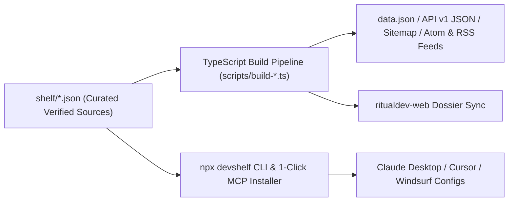

# 02 — DevShelf Architecture

## Registry Guarantees
- **Schema-Validated Catalog**: Every entry in `shelf/*.json` is validated against strict Zod schemas (`scripts/validate.ts`), verifying metadata (`freeTier`, `auth`, `selfHostable`, `license`, install commands, and active URLs).
- **Automated Uptime & Quality Telemetry**: Scheduled verification checks prevent dead links and stale packages from polluting developer workflows.
- **Zero-Touch Client Patching**: `bin/lib/mcp-installer.js` atomically updates IDE MCP JSON configs while preserving existing user-configured servers.
